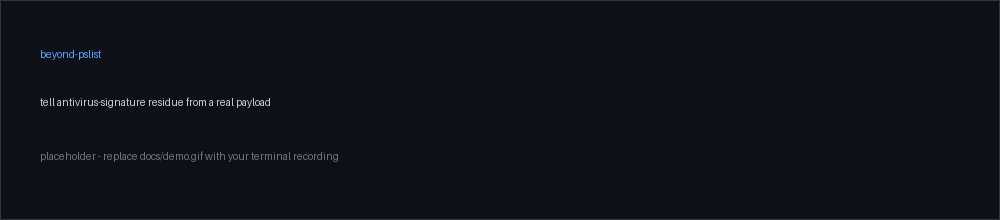

# beyond-pslist

**Your memory dump is full of malware strings that aren't malware. Here's how to tell the difference.**

[](https://github.com/AABurmov18/beyond-pslist/actions/workflows/ci.yml)
[](https://www.python.org/)
[](https://github.com/AABurmov18/beyond-pslist)
[](LICENSE)



Most memory forensics stops at the process list: run `pslist`, spot the odd process, check its
connections, write it up. That is the right first move, and it is where a lot of analysis stops.
beyond-pslist is a small toolkit for going further, built around one lesson that is very easy to
get wrong:

> A Windows memory image holds thousands of malware indicators (family names, C2 domains, crypto
> wallets, Telegram and Discord tokens, ransom notes) that are not resident malware. They are the
> antivirus engine's own signature database and AMSI scan buffers, mapped through process memory.
> Read as evidence, they invent infections that were never there.

The repo gives you the workflow, the regexes, the YARA, and a tool (`vdm-sift`) that separates
antivirus-signature **residue** from a **real payload**. A plain `strings | grep` cannot do that.

> **Use responsibly.** Only run these tools against images you are authorised to analyse. No
> forensic data ships in this repo; every value under `examples/` is synthetic and defanged.

## Install

```bash
pip install beyond-pslist           # or, from a clone:  pip install -e .
```

Pure standard library, with no third-party dependencies, so it runs on a locked-down analysis box.

## Quickstart (fully synthetic, no real data)

```bash
# 1. build two tiny synthetic dumps: a 'target' and a clean 'baseline'
python examples/make_synthetic.py

# 2. extract strings with offsets (ASCII + UTF-16LE)
bps strings examples/out/target.bin --min 6

# 3. read what a hit sits NEXT TO. this is the whole game.
bps context examples/out/target.bin "README_RECOVER"
#   shows the ransom note bracketed by a 'Ransom:Win64/...!MTB' label  => RESIDUE

# 4. is a carved region a real payload?
bps zcheck examples/out/carved_region.bin
#   0.00% non-zero, no MZ, no toolchain markers => NO payload evidence

# 5. the headline: subtract a clean baseline, then score each survivor
bps sift examples/out/target.bin examples/out/baseline.bin
#   fake wallet / token / family strings => RESIDUE (next to AV markers, or in the baseline)
#   the one planted non-signature IOC    => CANDIDATE (look closer, not 'confirmed bad')
```

## What's in here

| Path | What it is |
|---|---|
| `beyondpslist/` | the tools: `strings`, `context`, `zcheck`, `sift`, plus the shared `markers` library |
| `docs/METHODOLOGY.md` | the climb from `pslist` to deep artifacts, and the provenance discipline that keeps you honest |
| `docs/CHEATSHEET.md` | a Volatility 3 plugin runbook: which plugin surfaces which artifact, in order |
| `regex/ioc-regex.md` | copy-paste IOC regexes (IPv4, URL, BTC, Telegram, Discord, onion, email) |
| `regex/defender-vdm-markers.md` | the antivirus-signature marker patterns that flag residue |
| `yara/defender-residue.yar` | YARA rules that match signature-database content so you can exclude it |
| `examples/` | a synthetic dump generator and a fully defanged worked example |

## The one rule

The clean-baseline subtraction (`sift`) is a residue detector, not a residue excluder:

- **Valid (positive):** a string present in a process that cannot be infected (for example
  `dwm.exe`) is shared residue.
- **Invalid (negative):** a string being absent from that baseline does not make it genuine. A
  signature database is compressed and only partly resident, so a lone signature page easily looks
  "unique". The only thing that promotes a survivor is reading the bytes around it. If it sits next
  to `!MTB`, `Ransom:`, `#ATTR_`, `MHSTR:`, `!#SCRIPT:`, or is stored as ASCII immediately followed
  by its UTF-16LE copy, it is the antivirus's name for a threat, not the threat.

A `CANDIDATE` verdict means "nothing here marks it as a signature". It is a prompt to look closer,
not a confirmation that something is malicious.

## Volatility plugins this pairs with

`windows.info`, `pslist`, `pstree`, `netscan`, `malfind`, `vadinfo`, `svcscan`, `modules`,
`registry.hivelist/printkey`, `mftscan`, `consoles`, `timeliner`, `vadyarascan`,
`malware.hollowprocesses`, `malware.ldrmodules`. See `docs/CHEATSHEET.md`.

## Development

```bash
pip install -e ".[dev]"
pytest
```

## License

MIT, see [LICENSE](LICENSE).
